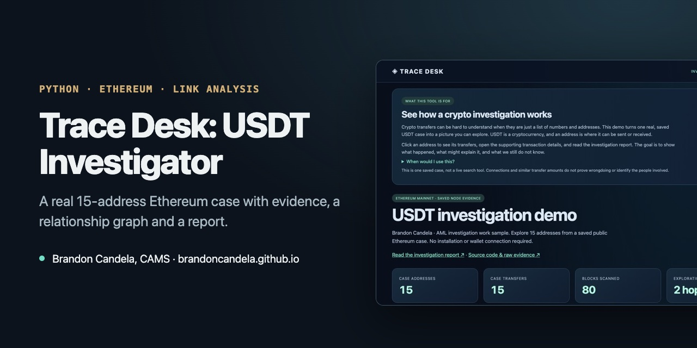

# Trace Desk: USDT Investigator



**[▶ Open the live demo](https://brandoncandela.github.io/usdt-investigator/)** · [Portfolio](https://brandoncandela.github.io/) · [LinkedIn](https://www.linkedin.com/in/brandon-candela/) · Built by Brandon Candela, CAMS, PMP

> **What this shows:** a reproducible blockchain investigation built from raw Ethereum node data: transaction evidence, a two-hop wallet graph and a written analyst report.

## What it is

A small investigation dashboard for one saved case. It reads USDT transfers straight from Ethereum's raw event logs, decodes them itself, picks one wallet and maps everyone it traded with up to two hops away. The result is 15 wallets and 15 transfers you can click through, plus a short written analysis in [CASE_REPORT.md](CASE_REPORT.md).

This was the first version of [Trace Desk](https://github.com/brandoncandela/trace-desk-aml-workspace), which later added live queries, case files and QC.

## Try it

1. Open the [live demo](https://brandoncandela.github.io/usdt-investigator/).
2. Click the gold starting wallet, or any other wallet, to filter the transfers.
3. Open a transaction to see the full addresses, transaction hash, raw amount and block.
4. Export the visible transfers as CSV, or the whole case as JSON.
5. Read the [case report](CASE_REPORT.md) for the analysis and the two-step transfer sequence it flags.

## How the case was built

- **Data:** 80 Ethereum blocks (25,929,879 to 25,929,958) with 7,640 USDT transfers, pulled from a public node in four 20-block batches.
- **Decoding:** sender, recipient and amount come from the raw log data. Amounts are kept as exact whole-number base units, never floating point.
- **Starting wallet:** the tool picks a wallet with 6 to 12 trading partners and money both coming in and going out. That keeps the case reviewable; it isn't a random sample.
- **Graph:** follows transfers in and out for two hops, up to 24 wallets. It shows who traded with whom. It doesn't follow the same dollars through time.
- **Checks:** before showing the case, the app verifies file checksums and block hashes against the saved data.

## Run it locally

Python 3.10 or later, no packages to install.

```sh
python3 app.py                       # then open http://127.0.0.1:8000
python3 -m unittest discover -s tests -v
python3 verify.py                    # re-checks the saved evidence
```

On a Mac you can also double-click `Launch.command`. To collect a fresh case from a public node:

```sh
ETH_RPC_URL=https://rpc.mevblocker.io python3 collect.py --blocks 80 --output fresh-data
```

Every raw node response is saved in `data/raw/`, and `data/manifest.json` records the settings and checksums, so the case rebuilds identically offline.

| File | What it does |
| --- | --- |
| `collect.py` | Pulls transfer logs and block headers from an Ethereum node |
| `investigator.py` | Decodes transfers and builds the two-hop graph |
| `verify.py` | Re-checks saved evidence against the manifest |
| `app.py` | Serves the dashboard locally |
| `tests/` | Decoding, limits, ordering and saved-case tests |

## Limits

- A wallet address isn't a person. No wallet is labeled as an exchange or individual.
- Matching amounts in sequence are a lead; they don't prove it's the same money.
- 80 blocks is a slice of activity, not a wallet's full history.
- This is a triage exercise on public data, not an accusation against anyone.

Built with AI coding tools. MIT license; the saved node data is included so results can be reproduced.
